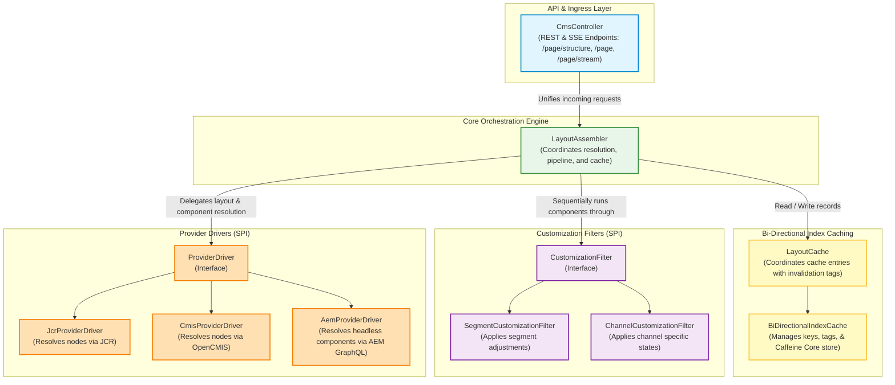
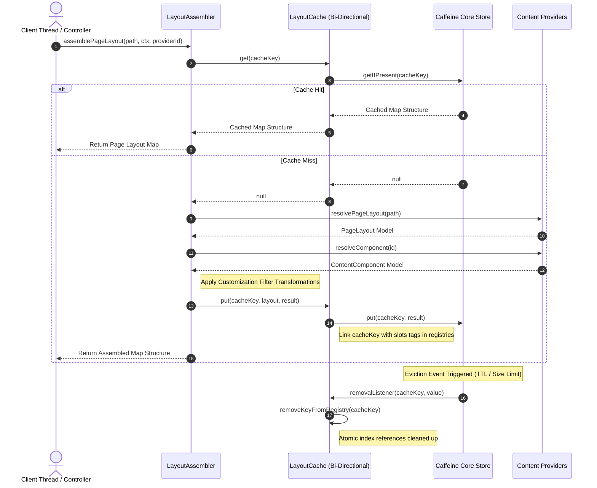
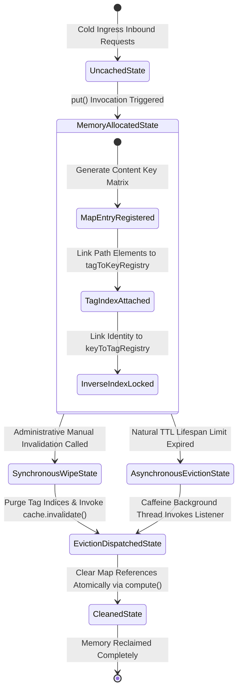

# Enterprise Content Mesh Framework (POC)

This repository serves as an architectural proof-of-concept demonstrating a high-throughput, non-blocking content federation layer. Built to solve vendor lock-in and migration fragmentation in enterprise environments, the framework acts as a unified abstraction layer over multiple content schemas—aggregating and customizing content dynamically at the orchestration boundary.

### Core Architecture Highlights
* **Reactive Core:** Engineered natively on **Project Reactor** and Spring WebFlux to guarantee non-blocking I/O execution loops under high concurrent stress.
* **Multi-Protocol Federation:** Abstracted driver pipeline resolving content seamlessly across modern Headless CMS (AEM GraphQL) and legacy enterprise systems (JCR/Jackrabbit, CMIS) concurrently.
* **Stateless Pipeline Customization:** Sequential, thread-safe in-memory filtering engine for on-the-fly localization, currency serialization, and dynamic targeting before layout delivery.

---

## 1. Architecture Overview

CMS Mesh is a high-performance content delivery framework designed to unify, target, and transform unstructured content across multiple Content Management Systems (CMS) including JCR/Jackrabbit repositories and CMIS-compliant systems. It integrates dynamic customization filters and an in-memory bi-directional cache.

### Component & Class Structure

The following diagram maps out the core classes, interfaces, and registry structures of the CMS Mesh platform.



### Lifecycle & Data Flow Sequence

This diagram details the lifecycle sequence of a page layout resolution when requested through the `LayoutAssembler`.



### Cache State Invalidation Lifecycle

The `BiDirectionalIndexCache` maintains tag-to-key and key-to-tag relationships. This diagram demonstrates how the cache shifts states programmatically or asynchronously.



---

## 2. Dynamic Configurations & Properties

### JCR and CMIS Properties Configuration

File configurations are driven by standard Spring Boot configuration loading.

#### `application.yml` Schema Example
```yaml
cms:
  mesh:
    default-provider: AEM_GRAPHQL # Default provider protocol used when none specified in request
    cache:
      enabled: true
      max-size: 50000
      expire-after-write-minutes: 15
    aem:
      graphql-endpoint: "https://publish-pXX-eYY.adobeaemcloud.com/graphql/execute.json/common/componentByPath"
      access-token: "YOUR_BEARER_TOKEN"
    jcr:
      user: admin
      password: admin
      transient-repo-dir-prefix: jacket-repo-
      repository-xml-name: /repository.xml
      sling-namespace-prefix: sling
      sling-namespace-uri: http://sling.apache.org/jcr/sling/1.0
      sling-template-property: sling:resourceType
      cq-template-property: cq:template
```

`MeshProperties.java`, `JcrProperties.java`, and `CmisProperties.java` are loaded dynamically at runtime via Spring `@ConfigurationProperties`.

---

## 3. Usage & Step-by-Step Guide

To instantiate and orchestrate the CMS Mesh pipeline:

### Step 1: Bootstrap properties
```java
// Configure the Cache and Default Provider Protocols
MeshProperties.CacheConfig cacheConfig = new MeshProperties.CacheConfig(true, 50000, 15);
MeshProperties properties = new MeshProperties(ProviderDriverProtocol.LOCAL_JCR, cacheConfig);
```

### Step 2: Assemble Components with Customization Pipelines
```java
// Create provider lists & customization filters
List<ProviderDriver> providerDrivers = List.of(jcrProvider, cmisProvider);
List<CustomizationFilter> customizationFilters = List.of(segmentCustomizationFilter, channelCustomizationFilter);

ProviderDriversRegistry registry = new ProviderDriversRegistry(properties.defaultProviderDriver(), providerDrivers);
CustomizationFiltersRegistry filtersRegistry = new CustomizationFiltersRegistry(customizationFilters);

// Instantiate the Pipeline Assembler
LayoutAssembler assembler = new LayoutAssembler(registry, filtersRegistry, cache);
```

### Step 3: Issue Page Assembly Requests
Using `Project Reactor`'s asynchronous publishers:
```java
String pagePath = "/content/home";
UserContext userCtx = new UserContext(Map.of(ContextKey.TIER, "VIP"));

assembler.assemblePageLayout(pagePath, userCtx, ProviderDriverProtocol.LOCAL_JCR)
    .subscribe(resultMap -> {
        // resultMap holds the PageLayout object containing resolved slot groups
        resultMap.slots().forEach((slot, group) -> {
            System.out.println("Slot: " + slot + " contains components: " + group.components().size());
        });
    });
```

---

## 4. Extending the Framework

CMS Mesh is modular. Extending the capability of the framework requires implementing one of two SPI interfaces:

### A. Implementing a Custom Provider Driver
To add support for a new CMS backend (e.g., AEM Content Services, Strapi CMS, or local files):
1. **Implement `ProviderDriver`** from package `net.bopsys.cms.mesh.spi`.
2. **Define a custom enum value** in `ProviderDriverProtocol.java` (e.g., `STRAPI_REST`).

```java
package net.bopsys.cms.mesh.provider;

import net.bopsys.cms.mesh.model.ContentComponent;
import net.bopsys.cms.mesh.model.ProviderDriverProtocol;
import net.bopsys.cms.mesh.model.PageLayoutDefinition;
import net.bopsys.cms.mesh.model.SlotGroupDefinition;
import net.bopsys.cms.mesh.spi.ProviderDriver;
import org.springframework.stereotype.Service;
import reactor.core.publisher.Mono;

@Service
public class StrapiProviderDriver implements ProviderDriver {

    @Override
    public ProviderDriverProtocol getSupportedProtocol() {
        return ProviderDriverProtocol.STRAPI_REST; // Map to enum specification
    }

    @Override
    public Mono<PageLayoutDefinition> resolvePageLayout(String pagePath) {
        // Build or query page metadata containing slotted arrays of component references
        return Mono.just(PageLayoutDefinition.builder()
                .pagePath(pagePath)
                .templateName("strapi-grid")
                .slots(java.util.Map.of("content", new SlotGroupDefinition("content", java.util.List.of("/comp/101"))))
                .build());
    }

    @Override
    public Mono<ContentComponent> resolveComponent(String componentPath) {
        // Retrieve and parse unstructured component from the strapi repository
        return Mono.just(ContentComponent.builder()
                .componentId(componentPath)
                .type("strapi/banner")
                .state(java.util.Map.of("headline", "Dynamic Banner Title"))
                .build());
    }
}
```

### B. Implementing a Custom Customization Filter
Customization filters intercept the components during execution before they are loaded into the slot layout mappings.
1. **Implement `CustomizationFilter`** from package `net.bopsys.cms.mesh.spi`.
2. Add the Spring Bean to the initialized lists injected into the `LayoutAssembler`.

```java
package net.bopsys.cms.mesh.pipeline;

import net.bopsys.cms.mesh.model.ContentComponent;
import net.bopsys.cms.mesh.model.UserContext;
import net.bopsys.cms.mesh.spi.CustomizationFilter;
import org.springframework.stereotype.Service;
import reactor.core.publisher.Mono;

@Service
public class GeolocationCustomizationFilter implements CustomizationFilter {

    @Override
    public Mono<ContentComponent> applyCustomization(ContentComponent incoming, UserContext userContext) {
        // Inspect Context parameters (e.g. COUNTRY) and conditionally modify components map inside state
        return Mono.just(incoming); 
    }
}
```

---

## 5. Testing and Validation

### Unit Testing via Gradle
To execute all local unit, parameterized, and reactive pipeline integration tests, use:
```bash
./gradlew test
```

### Functional/Integration Routing Tests via Postman/Newman
We maintain robust Newman integration test suites matching JSON configurations, HTTP status structures, invalidation pipelines and deep SSE streaming behaviors.

1. Ensure target server is running locally on port `3000`.
2. Install the Newman tool globally:
   ```bash
   npm install -g newman
   ```
3. Run the automated integration test matrix:
   ```bash
   newman run postman/CMS_Mesh_Collection.json
   ```
